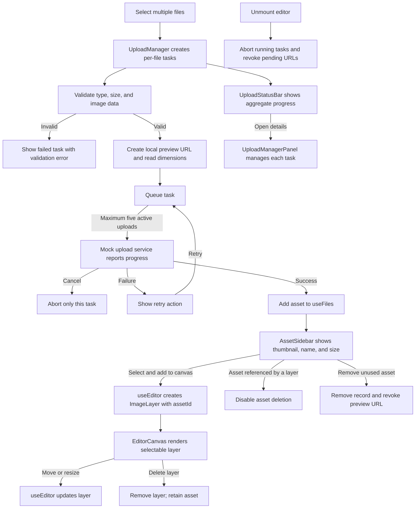

# Beauty Studio

## Overview
Beauty Studio is a React application built with TypeScript and Vite. This project serves as a template for creating a beauty-related web application, providing a structured setup with essential files and configurations.

## Getting Started

### Prerequisites
Make sure you have the following installed:
- Node.js (`^20.19.0` or `>=22.12.0`, as required by Vite 8)
- npm (comes with Node.js)

### Installation
1. Clone the repository:
   ```
   git clone <repository-url>
   ```
2. Navigate to the project directory:
   ```
   cd beauty-studio
   ```
3. Install the dependencies:
   ```
   npm install
   ```

### Running the Application
To start the development server, run:
```
npm run dev
```
Open your browser and go to `http://localhost:3000` to see the application in action.

The editor accepts multiple PNG, JPEG, and WebP images up to 10 MB each. Upload tasks run up to five at a time; successful simulated uploads add images to the local asset library. Select an asset and choose **Add selected to canvas** to create an independent canvas layer. To test a retryable mock failure, select a valid image with `[fail]` in its filename; its first upload attempt fails and its retry succeeds. The asset library starts expanded and can be collapsed to the icon toolbar. Upload details open from the bottom status bar while tasks are active or failed.
Select an image and drag a corner handle to resize it. Select any layer and press Delete or Backspace to remove it; keyboard deletion is disabled while editing a text or position field.

## Editor Data Flow



### State ownership

- `useFiles` owns uploaded assets and their object URL lifecycle. Assets stay in the library when a canvas layer is deleted.
- `useEditor` owns canvas layers and selection. Image layers reference library assets by `assetId`.
- `useUploadManager` owns queued/running task state and temporary previews; only successful tasks hand their asset to `useFiles`.
- `EditorPage` owns workspace layout and connects editor, asset, and upload state.
- `AssetSidebar` displays a selectable thumbnail grid; multiple canvas layers can reference the same asset independently.
- `LayersPanel` selects canvas objects; `PropertiesPanel` edits the selected layer in the same right sidebar.
- `UploadStatusBar` provides aggregate progress; `UploadManagerPanel` shows task-level progress, cancellation, and retry controls.

### Linting
Run ESLint to check the project source and configuration:
```
npm run lint
```

## Project Structure
```
beauty-studio
├── src
│   ├── features
│   │   └── editor
│   │       ├── EditorPage.tsx        # Workspace layout and state connections
│   │       ├── updateLayer.ts        # Updates a layer by ID
│   │       ├── useEditor.ts          # Owns editor layers and selection
│   │       ├── components
│   │       │   ├── AssetSidebar.tsx       # Collapsible asset thumbnail grid
│   │       │   ├── EditorCanvas.tsx       # Renders and selects canvas layers
│   │       │   ├── EditorToolbar.tsx      # Persistent narrow icon toolbar
│   │       │   ├── LayersPanel.tsx        # Lists and selects canvas layers
│   │       │   ├── PropertiesPanel.tsx    # Edits selected layer properties
│   │       │   ├── UploadManagerPanel.tsx # Detailed upload task controls
│   │       │   └── UploadStatusBar.tsx    # Aggregate upload progress
│   │       ├── hooks
│   │       │   └── useFiles.ts            # Owns assets and preview URLs
│   │       └── upload
│   │           ├── types.ts               # Upload task types
│   │           ├── uploadService.ts       # Mock upload with progress
│   │           └── useUploadManager.ts    # Task queue and concurrency
│   ├── types
│   │   ├── editor.ts                 # Shared editor layer types
│   │   └── files.ts                  # Uploaded asset types
│   ├── App.tsx                       # Connects editor state to the layout
│   ├── main.tsx                      # Entry point for the React application
│   ├── index.css                     # Global CSS styles
│   └── vite-env.d.ts                 # TypeScript definitions for Vite
├── public
│   └── favicon.svg      # Favicon for the application
├── package.json         # npm configuration file
├── tsconfig.json        # TypeScript configuration file
├── tsconfig.node.json   # Node.js specific TypeScript configuration
├── vite.config.ts       # Vite configuration file
├── index.html           # Main HTML file
├── README.md            # Project documentation
└── .gitignore           # Git ignore file
```

## Contributing
Contributions are welcome! Please open an issue or submit a pull request for any improvements or features.

## License
This project is licensed under the MIT License. See the LICENSE file for details.