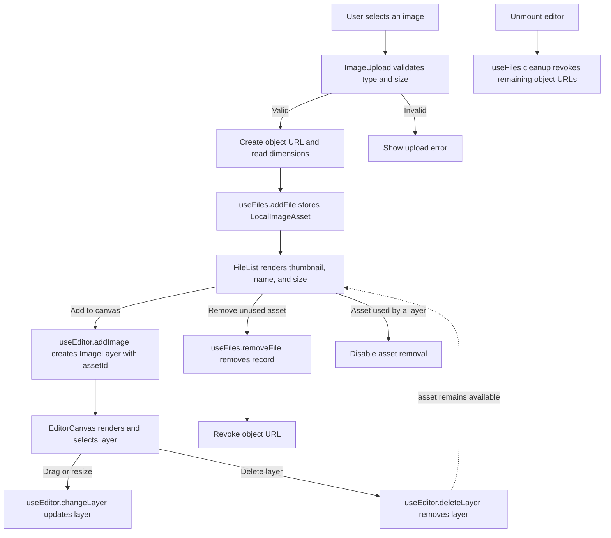

# Beauty Studio

## Overview
Beauty Studio is a React application built with TypeScript and Vite. This project serves as a template for creating a beauty-related web application, providing a structured setup with essential files and configurations.

## Getting Started

### Prerequisites
Make sure you have the following installed:
- Node.js (`^20.19.0` or `>=22.12.0`, as required by Vite 8)
- npm (comes with Node.js)

### Installation
1. Clone the repository:
   ```
   git clone <repository-url>
   ```
2. Navigate to the project directory:
   ```
   cd beauty-studio
   ```
3. Install the dependencies:
   ```
   npm install
   ```

### Running the Application
To start the development server, run:
```
npm run dev
```
Open your browser and go to `http://localhost:3000` to see the application in action.

The editor toolbar accepts PNG, JPEG, and WebP images up to 10 MB. Uploaded images appear in the local asset list; choose **Add to canvas** to create an image layer.
Select an image and drag a corner handle to resize it. Select any layer and press Delete or Backspace to remove it; keyboard deletion is disabled while editing a text or position field.

## Editor Data Flow



### State ownership

- `useFiles` owns uploaded assets and their object URL lifecycle. Assets stay in the library when a canvas layer is deleted.
- `useEditor` owns canvas layers and selection. Image layers reference library assets by `assetId`.
- `App` connects the hooks and passes their state and actions to `EditorLayout`.
- `EditorLayout` composes the toolbar, canvas, and properties panel; those components render UI and report user actions through callbacks.

### Linting
Run ESLint to check the project source and configuration:
```
npm run lint
```

## Project Structure
```
beauty-studio
├── src
│   ├── features
│   │   └── editor
│   │       ├── EditorCanvas.tsx      # Renders and selects canvas layers
│   │       ├── EditorLayout.tsx      # Composes the editor shell and panels
│   │       ├── EditorToolbar.tsx     # Left-side editor tools
│   │       ├── FileList.tsx          # Lists uploaded local image assets
│   │       ├── ImageUpload.tsx       # Validates and previews uploaded images
│   │       ├── PropertiesPanel.tsx   # Edits or deletes the selected layer
│   │       ├── updateLayer.ts        # Updates a layer by ID
│   │       ├── useEditor.ts          # Owns editor layers and selection
│   │       └── useFiles.ts           # Owns uploaded assets and preview URLs
│   ├── types
│   │   ├── editor.ts                 # Shared editor layer types
│   │   └── files.ts                  # Uploaded asset types
│   ├── App.tsx                       # Connects editor state to the layout
│   ├── main.tsx                      # Entry point for the React application
│   ├── index.css                     # Global CSS styles
│   └── vite-env.d.ts                 # TypeScript definitions for Vite
├── public
│   └── favicon.svg      # Favicon for the application
├── package.json         # npm configuration file
├── tsconfig.json        # TypeScript configuration file
├── tsconfig.node.json   # Node.js specific TypeScript configuration
├── vite.config.ts       # Vite configuration file
├── index.html           # Main HTML file
├── README.md            # Project documentation
└── .gitignore           # Git ignore file
```

## Contributing
Contributions are welcome! Please open an issue or submit a pull request for any improvements or features.

## License
This project is licensed under the MIT License. See the LICENSE file for details.